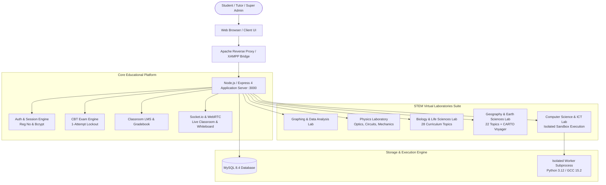
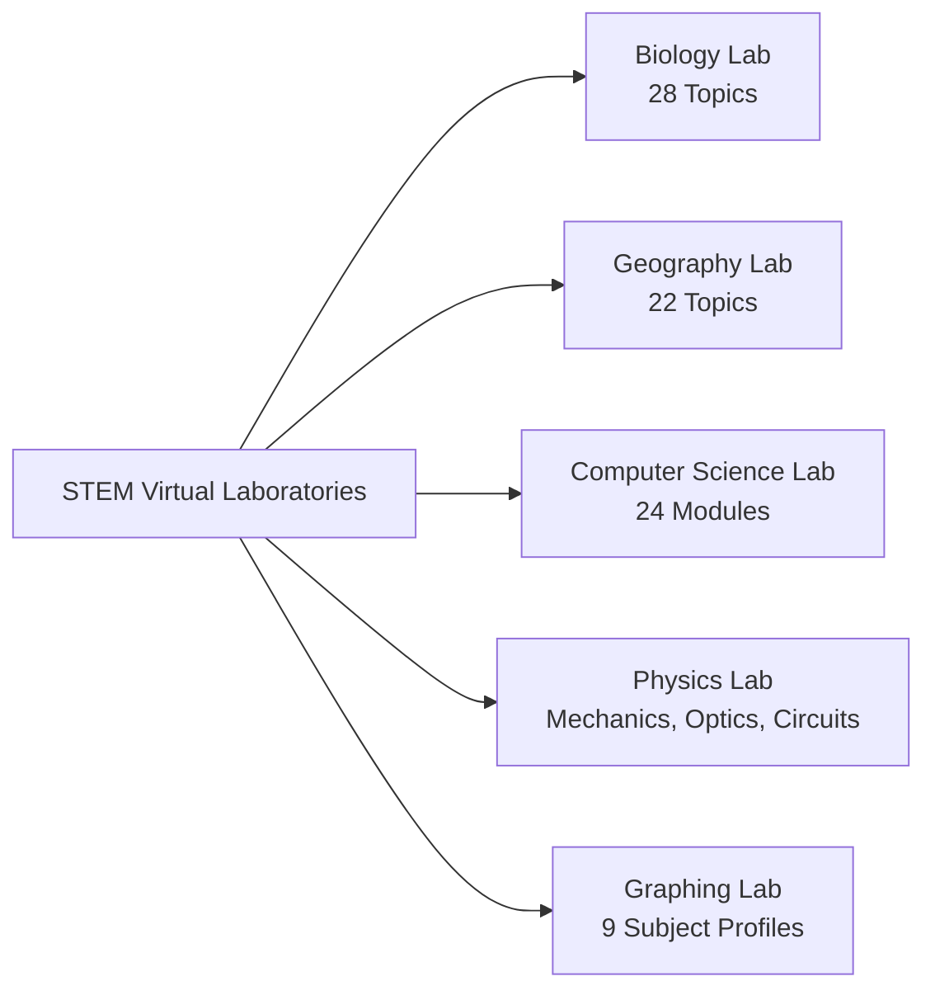
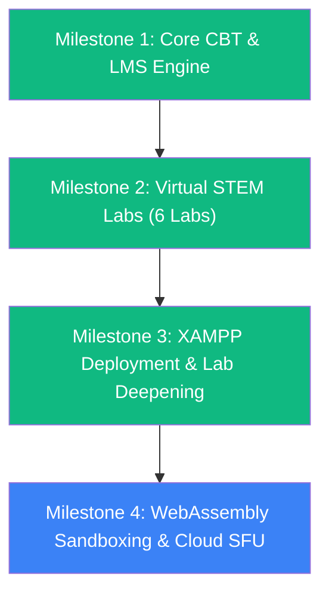

# CBT Platform & STEM Virtual Laboratories Suite — Master Architecture & Implementation Plan

> **System Status**: Production-Ready Active Development  
> **Host Server**: Windows 11 / XAMPP Apache + Node.js 24 + MySQL 8.4  
> **Core Deployment Paths**: `C:\xampp\htdocs\CBT` & `d:\CBT`  
> **Automated Test Coverage**: **161 / 161 Passed (100%)** across 6 independent suites

---

## 1. Executive Summary & System Vision

The **CBT + Digital Classroom & Advanced Virtual STEM Laboratories Platform** is an enterprise-grade educational technology system designed to deliver high-stakes examinations, synchronous hybrid classroom instruction, and realistic, interactive virtual laboratories for science, computing, and humanities subjects.



---

## 2. Technology Stack & Hosting Architecture

| Layer | Component | Specification / Notes |
|---|---|---|
| **Runtime Environment** | Node.js v24.14.0 | Server-side JavaScript with ES6+ modules and native async pooling |
| **Backend Framework** | Express 4.19+ | RESTful APIs, session management, static asset streaming |
| **Relational Database** | MySQL 8.4 (Port 3306) | `mysql2/promise` connection pool, ACID transactional integrity |
| **Web Server / Proxy** | Apache 2.4 (XAMPP) | Port 80 reverse proxy with `.htaccess` rewrite rules and `index.php` bridge |
| **Real-time Engine** | Socket.io 4.8 + WebRTC | Collaborative whiteboard sync, peer video/audio, screen sharing, chat |
| **Frontend Architecture**| Vanilla Modern JavaScript | No heavy framework bloat; fast 60 FPS HTML5 Canvas, SVG, Leaflet, Three.js |
| **Mapping Engine** | Leaflet 1.9 + CARTO Voyager | Vector/raster tiles with API key `cb1_4tlk_1_c350409336a0563b146c80d8` |
| **3D Graphics Engine** | Three.js (WebGL) | Geomorphological landforms, rift valleys, folding strata, Earth-Sun geometry |
| **Code Sandbox** | Subprocess Execution Engine | Python 3.12, MinGW-w64 GCC 15.2.0; stripped environment, execution quotas |

---

## 3. Core Subsystems & Functional Modules

### 3.1 Authentication & Assessment Core
- **Student Authentication**: Registration Number login supporting legacy and academic formats (`STO1-001A`, `2026/ICT/001`, `STU-2026-042`).
- **Administrative Roles**: Three-tier hierarchy (`super_admin`, `ordinary_admin`, `tutor`) with bcrypt password hashing (cost factor 12).
- **CBT Examination Engine**:
  - Secure random question delivery and option shuffling.
  - Periodic autosave of student responses.
  - **Strict One-Attempt Protection**: Immediate database lock upon submission preventing duplicate attempts.
  - Automated objective scoring and spatial coordinate tolerance grading.

### 3.2 Digital Classroom & Synchronous Live Suite
- **Classroom LMS**: Sections, enrollments, lessons, learning resources, assignments, quizzes, attendance, and threaded discussions.
- **Unified Gradebook**: Composite grade aggregation weighting assignments, quizzes, and CBT exams with automatic letter grade assignment.
- **Live Classroom & WebRTC Whiteboard**:
  - Teacher screen sharing (entire screen, application window, or browser tab).
  - Synchronous two-way audio/video with device selectors.
  - Collaborative drawing canvas with shapes, freehand brushes, mathematical grids, and direct toolbar shortcuts to all 5 STEM labs.
  - Tutor lesson notes drawer for annotations during live demonstrations.

---

## 4. The 5 Virtual STEM Laboratories



### 4.1 Interactive Biology & Life Sciences Laboratory (`/biology-lab.html`)
Comprehensive coverage of all **28 curriculum modules** with dedicated interactive 2D canvas visualizations, real-time HUD telemetry, and apparatus filtering:

1. **Introduction to Biology & Life Characteristics**: MRS GREN organism criteria board & metabolic pathways.
2. **Laboratory Apparatus & Tooling**: Interactive preparation bench (dissection kit, glass slides, cover slips, staining reagents).
3. **Cell Structure & Organization**: Plant mesophyll vs animal cheek cell comparative ultrastructure.
4. **Microscopy & Specimen Preparation**: Compound optical microscope field with calibrated eyepiece graticule ($M = I/A$).
5. **Classification & Biodiversity**: Linnaean hierarchical dichotomous branching taxonomic key.
6. **Plant Anatomy & Physiology**: Dicotyledonous stem and leaf transverse section vascular bundles.
7. **Human Anatomy & Organ Systems**: Multi-chamber cardiovascular torso with aorta and cardiac cycle.
8. **Animal Biology & Tissue Specialization**: Striated skeletal muscle fiber histology and motor endplate synapses.
9. **Nutrition & Digestive Chemistry**: Biochemical qualitative food test tubes (Benedict, Biuret, Iodine, Emulsion).
10. **Cellular Respiration & Gas Exchange**: Respirometer apparatus with germinating seeds and manometer U-tube.
11. **Photosynthesis & Plant Energy**: Inverted funnel *Elodea* oxygen evolution bubbler with adjustable lux distance.
12. **Transport in Plants & Animals**: Ganong's bubble potometer transpiration apparatus and erythrocyte capillary flow.
13. **Excretion & Osmoregulation**: Renal nephron unit with Bowman's capsule, glomerulus, and Loop of Henle.
14. **Coordination & Response**: Sensory-motor reflex arc pathway and synaptic neurotransmitter cleft.
15. **Reproduction in Plants & Animals**: Dissected angiosperm flower morphology (stamen, carpel, ovary, ovules).
16. **Growth & Development**: Seed germination chamber and sigmoid growth curve phases.
17. **Genetics & Inheritance**: Monohybrid/dihybrid Punnett square board ($Aa \times Aa \to 3:1$ ratio).
18. **Variation & Evolution**: Industrial melanism natural selection simulator (*Biston betularia* morphs).
19. **Ecology & Ecosystem Dynamics**: Savanna grassland trophic food web and 10% biomass energy pyramid.
20. **Microbiology & Infectious Diseases**: Kirby-Bauer antibiotic sensitivity assay with clear inhibition zones.
21. **Immunology & Body Defense**: Macrophage phagocytosis and Y-shaped antibody-antigen lock-and-key complex.
22. **Biotechnology & Genetic Engineering**: Agarose gel electrophoresis tank with UV DNA ladder bands.
23. **Homeostasis & Feedback Systems**: Negative feedback control loop (insulin/glucagon glucose regulation).
24. **Environmental Biology & Conservation**: Freshwater eutrophication lake transect and biological oxygen demand.
25. **Virtual Experiments Workbench**: Controlled enzyme catalysis hydrolysis workbench with thermostatic water bath.
26. **Specimen & Slide Library**: Museum-grade botanical herbarium mount and histological slide carousel.
27. **Biological Graphing & Data Analysis**: Michaelis-Menten enzyme saturation kinetics ($v$ vs $[S]$) and Lineweaver-Burk plots.
28. **Practical Assessments & CBT**: Strict UNEB/Cambridge biological drawing assessment with calibrated scale bar.
- **Search & Filtering**: Real-time filtering across 11 specimen categories with automatic category expansion.

---

### 4.2 Interactive Geography & Earth Sciences Laboratory (`/geography-lab.html`)
Full 22-topic geospatial curriculum with CARTO Voyager basemap integration:
- **CARTO Voyager Basemaps**: Active API key `cb1_4tlk_1_c350409336a0563b146c80d8` powering high-resolution topographic and cultural layers.
- **Leaflet GIS Engine**: Multi-layer overlays (relief, lakes, rivers, national parks, rift faults, plate tectonics, districts), 4/6-figure grid references, distance/polygon area measurement, true & back compass bearings, and 50 km proximity buffers.
- **Three.js 3D Landforms**: Rift valleys, normal/reverse faults, anticline/syncline folding, volcanoes, glacial U-valleys, horst blocks, and Earth-Sun seasonal geometry.
- **Hydrology & Meteorology**: Psychrometric hygrometer ($RH\%$, dew point), solar declination/day length calculator, and dynamic storm hydrograph unit graph simulation.
- **Demographics & Environmental Change**: Expansive age-sex population pyramid (UBOS 2024 census) and Rwenzori glacial recession time-series (1906–2024).
- **CBT Spatial Auto-Grading**: Real-time Haversine distance pin grading with configurable tolerance thresholds.

---

### 4.3 Virtual Computer Science & ICT Laboratory (`/cs-lab.html`)
Modular, professional-grade computing laboratory:
- **24 Curriculum Modules**: Computer Fundamentals, Programming IDE, Web Development, Databases, Networking, Cybersecurity, OS, Hardware, Office Apps, AI/Data Science, Algorithms, and Practical CBT.
- **Monaco Code Editor**: Line numbering, syntax highlighting, bracket matching, code folding, multi-file tabs, and keyboard shortcuts.
- **Language Adapters & Runtimes**: Python 3.12, JavaScript (Node/Browser), C/C++ (MinGW GCC 15.2.0), HTML/CSS live rendering, and SQL.
- **Isolated Sandbox Execution**:
  - Student code is executed in isolated worker subprocesses with strict timeouts (5–10s) and memory caps.
  - **Zero Access to Host Credentials**: Database passwords, session secrets, and application server environment variables are completely stripped before execution.
  - Safe SQL query execution blocking dangerous statements (`DROP`, `ALTER`, `TRUNCATE`).

---

### 4.4 Physics Virtual Laboratory (`/physics-lab.html`)
- **Ray Optics & Lenses**: Convex/concave lenses, focal length calculation, refraction, Snell's law, and real/virtual image inversion.
- **Mechanics & Dynamics**: Inclined planes, friction coefficients, projectile trajectories, and Newton's laws.
- **Circuits & Electricity**: DC circuit simulator with resistors, capacitors, ammeters, voltmeters, and Ohm's law verification.
- **Wave Motion & Sound**: Wave interference, superposition, standing waves, resonance, and Doppler effect.

---

### 4.5 Graphing & Data Analysis Laboratory (`/graphing-lab.html`)
- **9 Subject Profiles**: Mathematics, Physics, Chemistry, Biology, Economics, Statistics, Geography, Agriculture, Computer Science.
- **Mathematical Formula Engine**: Polynomial, trigonometric, logarithmic, and parametric function rendering.
- **Statistical Regression**: Linear, quadratic, exponential, and power curve fitting with $R^2$ determination.
- **Direct Lab Integration**: One-click preset loading from Biology, Geography, and Physics laboratories.

---

### 4.6 Chemistry & Chemical Sciences Laboratory (`/chemistry-lab.html`)
- **33 Comprehensive Curriculum Topics**: Covers all 8 core branches (Foundations, Physical, Inorganic, Organic, Analytical, Environmental, Industrial, Biochemistry, and Practical Assessments).
- **2D Apparatus Canvas (`chem-canvas.js`)**: Real-time vector-based apparatus rendering (beakers, conical flasks, burettes, pipettes, test tubes, Bunsen burners, separating funnels, condensers, electrolysis cells, pH indicator strips) with dynamic liquid meniscus, bubbles, and thermometer columns.
- **3D Molecular & Bohr Atomic Shell Engine (`chem-3d-engine.js`)**: Three.js-powered real-time 3D Bohr atomic shell models ($2n^2$ orbital shells, animated orbiting electrons, nucleus composition $Z$ and $A-Z$) and ball-and-stick molecular models (H₂O, CO₂, NH₃, CH₄, HCl, C₂H₆, C₂H₄, and VSEPR geometries: linear, bent, trigonal planar, tetrahedral, octahedral).
- **Interactive 118-Element IUPAC Periodic Table**: Complete dataset with classifications, atomic masses, Pauling electronegativities, electron configurations, and oxidation states.
- **Scientific Computational Backends**:
  - **Equation Balancer**: Gaussian matrix elimination conservation solver.
  - **Stoichiometry Engine**: Mass-to-mole conversions, limiting reagents, and theoretical yield.
  - **pH / Acid-Base Calculator**: $[\text{H}^+]$, $[\text{OH}^-]$, $\text{pH}$, and $\text{pOH}$ for strong monoprotic acids/bases and weak acid Ostwald equilibrium.
  - **Ideal Gas Engine**: Solves $PV = nRT$ for pressure, volume, moles, or temperature with $R = 8.314\text{ kPa}\cdot\text{dm}^3/(\text{mol}\cdot\text{K})$.
  - **Titration Bench & Sigmoidal Curve Generator**: Interactive burette delivery, indicator threshold transitions, and equivalence point volume calculation.
- **Laboratory Safety & GHS Standards**: GHS hazard pictograms, safety protocol cards, and PPE requirements.
- **CBT Examination Auto-Grading**: Equation balancing, stoichiometry numerical tolerance grading, and qualitative ion identification question types.

---

## 5. Automated Test Suite Verification

All 7 automated test suites run synchronously or independently with **zero failures**:

```text
======================================================================
TEST SUITE SUMMARY — 100% PASS RATE
======================================================================
1. Platform & CBT Integration Engine:      44 / 44 Assertions Passed
2. Graphing & Mathematical Analysis Lab:    30 / 30 Assertions Passed
3. Physics Virtual Laboratory:              15 / 15 Assertions Passed
4. Biology & Life Sciences Laboratory:      21 / 21 Assertions Passed
5. Geography & Earth Sciences Laboratory:   30 / 30 Assertions Passed
6. Computer Science & ICT Laboratory:       21 / 21 Assertions Passed
7. Chemistry & Chemical Sciences Lab:       30 / 30 Assertions Passed
----------------------------------------------------------------------
TOTAL AUTOMATED INTEGRATION TESTS:         191 / 191 PASSED (100%)
======================================================================
```

---

## 6. Project Roadmap & Future Enhancements



### Completed Milestones
- [x] **Milestone 1**: Robust CBT exam engine, one-attempt lockout, student registration login, role hierarchy, and unified gradebook.
- [x] **Milestone 2**: Construction of all 6 virtual STEM laboratories (Graphing, Physics, Biology, Geography, Computer Science, and Chemistry).
- [x] **Milestone 3**: XAMPP Apache integration (`C:\xampp\htdocs\CBT`), CARTO Voyager basemap integration, 28-topic Biology simulation expansion, 22-topic Geography spatial alignment, 24-module CS sandbox hardening, and 33-topic Chemistry laboratory with 3D Three.js molecular/Bohr models and matrix equation balancer.

### Future Enhancement Milestones
- [ ] **Milestone 4 (Next)**:
  - Add WebAssembly (Wasm) in-browser runtimes for Python (Pyodide) and SQLite for zero-latency client-side execution.
  - Integrate LiveKit Cloud SFU credentials into production `.env` for multi-party high-bandwidth video streaming.
  - Implement mobile Android emulator WebSocket streaming for the CS Lab Android development track.
  - Add automated PDF laboratory report generation with student graphs and observation tables.
